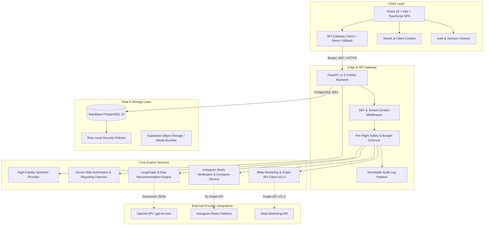
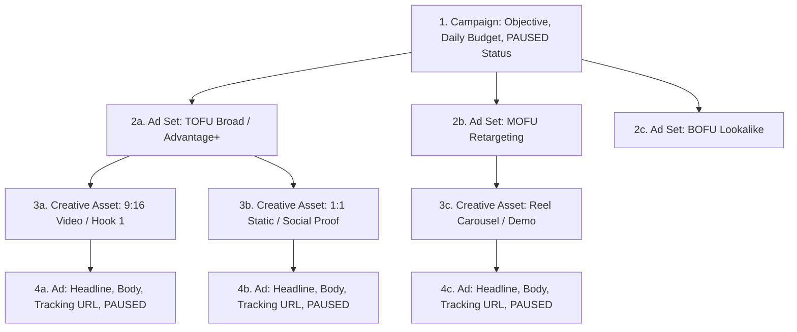
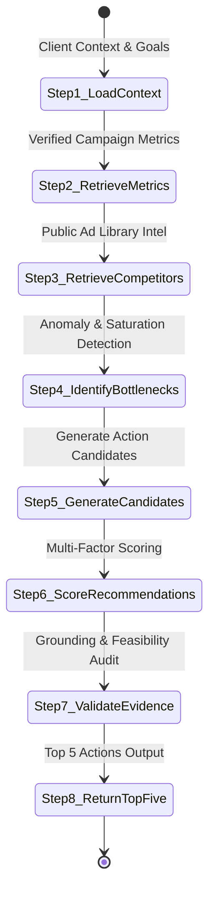
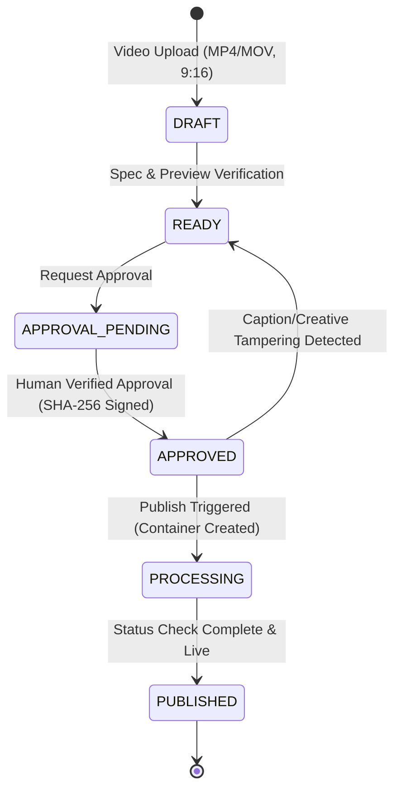
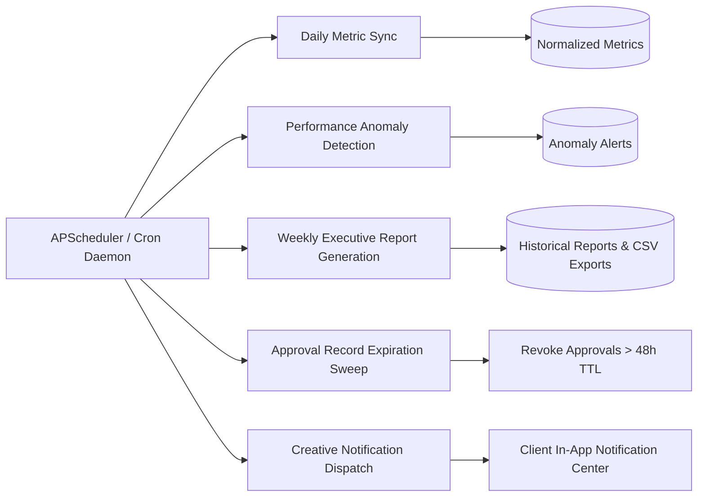

# MetaPilot AI - Complete System Architecture

## 1. Executive Summary & Architecture Vision
MetaPilot AI is a dual-mode, multi-tenant AI marketing operating system engineered for growth agencies and DTC brands managing advertising campaigns across the Meta ecosystem (Facebook & Instagram).

The platform bridges autonomous AI strategy generation (via LangGraph) with an unyielding security barrier:
1. **Zero Uncontrolled Autonomous Actions**: All state-mutating actions (budget scaling, campaign activations, Reel publishing) are strictly prohibited from autonomous execution.
2. **Deterministic State Guardrails**: Campaigns are guaranteed to initialize in `PAUSED` status.
3. **Cryptographic Sign-off**: Actions require explicit human approval anchored by a SHA-256 payload binding hash.
4. **Tenant Isolation**: Multi-tenant data isolation is enforced at the database layer (Supabase PostgreSQL RLS) and API layer (FastAPI tenant middleware).
5. **Transparent Dual-Mode Operation**: The platform operates in **Connected Mode** (live Meta Graph API v21.0 & OpenAI API) or **Demo Mode** (deterministic, offline synthetic fixtures).



---

## 2. Multi-Tenant Agency Model

### 2.1 Entity Hierarchy
The data model enforces a three-tier hierarchical tenancy structure:
```
Organization (Agency / Enterprise Tenant)
  └── Client Workspaces (Individual Brand / Ad Account Containers)
        ├── Campaigns (4-Tier Hierarchy: Campaign -> Ad Sets -> Creatives -> Ads)
        ├── Instagram Reels (Container Pipelines, Captions & Schedule)
        ├── Normalized Analytics (Spend, Impressions, Link Clicks, Conversions)
        ├── AI Recommendations (LangGraph Structured Insights & Feedback)
        ├── Automations & Background Jobs (Cadence, Anomaly Logs, Reports)
        └── Immutable Audit Logs (Security & Compliance Trail)
```

### 2.2 Role-Based Access Control (RBAC)
User access within each organization is categorized into four roles:
| Role | Permissions | Approval Authority |
| :--- | :--- | :--- |
| **Owner** | Full organization control, billing, client provisioning, API credentials | Full approval authority on all budgets and activations |
| **Admin** | Client workspace management, team invites, Meta connection config | Authorized to approve budgets up to organization limit |
| **Member / Media Buyer** | Create campaign drafts, upload Reels, run AI strategies | Can request approvals; cannot self-approve live activations |
| **Viewer / Client Guest** | Read-only access to analytics dashboards, reports, and audit logs | No execution or approval permissions |

### 2.3 Row-Level Security (RLS) Enforcement
Supabase PostgreSQL RLS policies restrict all table reads and writes using the authenticated user's session claims:
```sql
CREATE POLICY "tenant_isolation_policy" ON campaigns
FOR ALL USING (
    organization_id IN (
        SELECT organization_id FROM organization_memberships
        WHERE user_id = auth.uid()
    )
);
```
FastAPI enforces corresponding authorization checks (`require_org_member`, `require_org_admin`, and `verify_client_access`), preventing Insecure Direct Object References (IDOR) on client and organization endpoints.

---

## 3. Four-Tier Meta Marketing Hierarchy

Campaign generation models Meta's exact production hierarchy:



### 3.1 Strict Pre-Flight Rules
Before a campaign draft can be generated or updated, it must pass deterministic pre-flight validation rules:
1. **ODAX Objective Alignment**: Objective must be an official Meta ODAX objective (`OUTCOME_SALES`, `OUTCOME_LEADS`, `OUTCOME_ENGAGEMENT`, `OUTCOME_TRAFFIC`, `OUTCOME_AWARENESS`, `OUTCOME_APP_PROMOTION`).
2. **Budget Floor & Ceiling**: Daily budget must meet Meta's $1.00 minimum floor and remain within the client workspace's configured ceiling.
3. **Audience Specification**: Target countries (ISO 3166-1 alpha-2), age ranges (18-65+), and interest IDs verified against the `MetaTargetingRegistry`.
4. **Guaranteed PAUSED Initialization**: Newly drafted campaigns, ad sets, and ads are initialized in `PAUSED` status.

---

## 4. LangGraph Marketing Recommendation Engine

The recommendation engine implements an 8-step sequential state machine powered by LangGraph:



### 4.1 State Machine Workflow Steps
1. **Load Current Client Context**: Ingests industry vertical, target ROAS goals, monthly budget, and active campaigns.
2. **Retrieve Verified Campaign Performance**: Queries normalized performance metrics (spend, frequency, CTR, CPC, conversions, ROAS).
3. **Retrieve Competitor Intelligence**: Loads verified public Meta Ad Library observations and creative hook distributions.
4. **Identify Performance Bottlenecks**: Analyzes creative fatigue (frequency > 3.5 with declining CTR), high CPMs, or conversion drop-offs. Entities with spend < $100 or results < 10 are flagged with **insufficient data warnings**.
5. **Generate Candidate Recommendations**: Formulates targeted interventions across 9 predefined categories.
6. **Score Each Recommendation**: Calculates priority score (1-100) combining projected marginal ROAS lift, confidence, effort, and risk.
7. **Validate Evidence and Feasibility**: Audits supporting data citations and verifies zero ROI fabrication. Actions modifying budget or live campaign state are tagged with `approval_required = True`.
8. **Return Exactly Five Prioritized Actions**: Returns the 5 highest-ranking actions formatted into a typed JSON schema.

---

## 5. Instagram Reels Studio Container Pipeline

The Reels publishing pipeline adheres to official Instagram Graph API specifications:



### 5.1 Verification Guardrails
- **MPEG-4 / QuickTime Validation**: Allowed MIME types `video/mp4` and `video/quicktime`.
- **Vertical Aspect Ratio**: Enforces 9:16 vertical video ratio with tolerance for standard 1080x1920 resolutions.
- **Duration & Size Bounds**: Video length constrained between 3.0 seconds and 90.0 seconds; max file size 100MB.
- **Competitor Creative Safeguard**: Reels flagged as competitor rips or restricted third-party assets are rejected.
- **Cryptographic Binding**: User approval binds the exact video URL, caption, and hashtags into a SHA-256 hash. Any edit to the caption or asset immediately revokes approval.
- **Idempotency**: Publishing requests require an `idempotency_key` preventing double-posting.

---

## 6. Server-Side Automations & Background Engine

The automation subsystem handles periodic background synchronization and compliance tasks:



### 6.1 Automation Guardrails
- **Safe Tasks (Autonomous)**: Metric synchronization, anomaly scanning, report compilation, draft generation.
- **Restricted Tasks (Gated)**: Live campaign activation, Reel publication, budget scale requests.
- **Budget Limit Enforcement**: Daily budget modifications exceeding the client's configured ceiling are blocked server-side and recorded in the audit log.
- **Approval Expiration**: Approval records carry a 48-hour time-to-live (TTL); expired approvals are invalidated.

---

## 7. Dual-Mode Runtime Architecture

| Dimension | Connected Mode | Demo / Simulation Mode |
| :--- | :--- | :--- |
| **Trigger** | Valid Meta Token + App Secret in `.env` | Default (`EXECUTION_MODE=demo` or missing credentials) |
| **Meta Graph API** | Live calls to `graph.facebook.com/v21.0` | High-fidelity synthetic fixture provider |
| **OpenAI / LangGraph** | Live calls to `api.openai.com` | Structured deterministic fallback pipeline |
| **Campaign Creation** | Creates `PAUSED` campaigns in Ad Account | Generates synthetic campaign IDs with cached payloads |
| **Reel Publishing** | Creates Instagram IG Media Containers | Returns simulated Instagram permalinks |
| **Provenance Labeling** | Labeled as `LIVE_META_INTEGRATION` | Explicitly labeled as `DEMO_SYNTHETIC_DATA` in UI & API |

---

## 8. Directory & Technology Map

```
Meta Ads Expert/
├── backend/
│   ├── app/
│   │   ├── api/v1/          # FastAPI route controllers
│   │   ├── core/            # Security, config, audit logger, exceptions
│   │   ├── schemas/         # Typed Pydantic v2 domain schemas
│   │   ├── services/        # Meta API, Reels, AI agents, automations, demo fixtures
│   │   ├── dependencies.py  # RBAC & tenant isolation dependencies
│   │   └── main.py          # Application entrypoint & CORS middleware
│   ├── tests/               # 70 Pytest test suites (100% passing)
│   ├── requirements.txt     # Python runtime dependencies
│   └── Dockerfile           # Multi-stage production container
├── frontend/
│   ├── src/
│   │   ├── components/      # Modular UI components & design system
│   │   ├── context/         # AuthContext, ClientContext, ThemeContext
│   │   ├── pages/           # 15 React application views
│   │   ├── services/        # API client with automatic demo fallback
│   │   ├── types/           # Strict TypeScript interfaces
│   │   └── tests/           # 58 Vitest test suites (100% passing)
│   ├── package.json         # Node runtime & build scripts
│   └── vite.config.ts       # Vite bundler & proxy configuration
├── supabase/
│   └── migrations/          # PostgreSQL schemas, RLS policies, audit logs
└── docs/                    # Architectural & operational documentation
```
